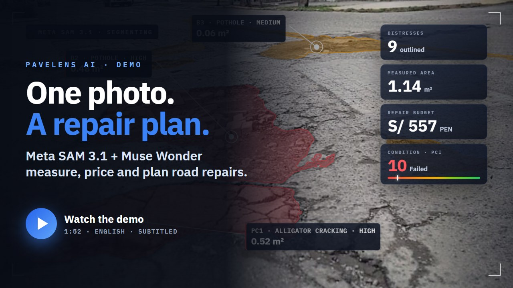
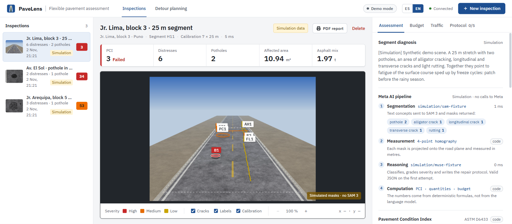

# PaveLens AI 🛣️

> **Meta Global AI Developer Hackathon · Indie Developer Track**
> Diagnóstico de pavimentos a partir de una foto: Meta SAM 3 segmenta cada deterioro, la geometría lo lleva a metros reales y PaveLens calcula PCI (ASTM D6433), cubicaje, presupuesto (APU) y el impacto de cerrar el tramo en el tráfico. Muse Wonder clasifica, explica y planifica la obra.

*Read in English: [README.md](README.md)*

## Video de demostración

[](docs/media/PaveLens_AI_demo.mp4)

**[▶ Ver la demo (1:52, MP4)](docs/media/PaveLens_AI_demo.mp4)** · [YouTube](https://youtu.be/bFq20ClnQ1o) · [Subtítulos en inglés (.srt)](docs/media/PaveLens_AI_demo.en.srt)

El video está narrado en inglés y muestra una ejecución real con los modelos de Meta. El análisis de 89 segundos aparece acelerado y rotulado como tal, y el planificador de desvíos corre sobre la red sintética de demostración del centro de Puno.

| Minuto | Sección |
|---|---|
| 0:00 | Apertura: SAM 3.1 delinea y mide cada deterioro |
| 0:09 | El problema en Puno, Perú |
| 0:27 | Una foto, una escala, un clic |
| 0:32 | El análisis real |
| 0:36 | 01 Ver: segmentación con Meta SAM 3.1 |
| 0:44 | 02 Razonar: el agente Muse Wonder y su revisor independiente |
| 1:01 | 03 Calcular: PCI, presupuesto y recálculo con la profundidad medida en campo |
| 1:14 | 04 Planificar: desvíos con equilibrio de tránsito de Wardrop |
| 1:28 | El resultado |
| 1:39 | Código abierto en GitHub |



Más capturas (presupuesto y planificador de desvíos) en el [README en inglés](README.md#screenshots). Están en modo demostración, que la app indica en cada pantalla.

## Documentación

- [Reporte técnico de orquestación con una clave de Meta](docs/ORQUESTACION_AGENTICA_META.es.md): arquitectura, activación directa, contratos, límites y validación pendiente.
- [Reporte de implementación, revisión del frontend y pendientes para el hackathon](docs/REPORTE_IMPLEMENTACION.es.md).
- [Orquestación de agentes, SAM 3.1 directo, perfiles regionales y mapas](backend/docs/ORCHESTRATION.md): configuración, evidencia y límites actuales.
- [tematica.md](tematica.md): el producto, el problema que resuelve y el flujo de usuario.
- [DESAFIO.md](DESAFIO.md): bases del hackathon, rúbrica, textos de postulación y guion del video.
- [PLANIFICACION.md](PLANIFICACION.md): plan y fundamentos (proyección al plano, PCI, cubicaje, APU MTC, BPR + Wardrop).
- [backend/README.md](backend/README.md): ejecución, configuración y API.
- [backend/docs/ARCHITECTURE.md](backend/docs/ARCHITECTURE.md): capas, pipeline, modelos de ingeniería y almacenamiento.
- [backend/docs/ai-contracts.md](backend/docs/ai-contracts.md): contratos con SAM 3 y Muse Wonder.

## Qué hace

1. **Segmentación.** SAM 3 recibe la foto y los conceptos `pothole`, `alligator crack`, `longitudinal crack`, `transverse crack` y `rutting`, y devuelve un polígono por deterioro. Si dos conceptos devuelven la misma máscara, se conserva la de mayor confianza.
2. **Medición en metros.** La foto se sube o se toma con la cámara del dispositivo. Con una foto cenital basta el ancho visible de la calzada. Para una foto oblicua se marcan en pantalla 4 esquinas de un rectángulo conocido y se calcula una homografía; una cuadrícula de 1 m proyectada sobre la foto permite verificar la calibración. Antes de analizar, la app estima la resolución en mm/px, la fisura más fina medible y la superficie evaluada. Sobre el polígono proyectado se miden área (Green), perímetro, largo × ancho orientados y excentricidad. Las pruebas verifican que cada máscara mide el área real dibujada con un error menor al 1 %.
3. **Diagnóstico.** Muse Wonder recibe la foto y las medidas ya calculadas, y asigna código, tipo, severidad, hallazgo e intervención, más un protocolo de obra. El modelo **no** calcula áreas, cantidades ni costos: eso lo hace el código, para que una alucinación no infle un presupuesto.
4. **PCI (ASTM D6433).** Valores deducidos por densidad, número máximo de deducidos *m* y CDV iterativo. Si la foto cubre menos de 135 m², el PCI se marca como parcial (cota superior).
5. **Cubicaje y APU.** Corte rectangular con margen, volumen y toneladas de mezcla. Partidas MTC con precios en soles (PEN), gastos generales, utilidad e IGV, y condiciones de obra para Puno (3 827 m s. n. m.). La profundidad medida en campo reemplaza a la supuesta y recalcula todo.
6. **Planificación de desvíos.** Cierre de carriles en una red de demostración del centro de Puno, sobre un mapa con flujo por sentido. Asignación de equilibrio de Wardrop (Frank-Wolfe + BPR) por franja (hora punta, valle, noche) y duración de la obra. Devuelve las veh·h perdidas, los tramos que absorben el desvío y el costo social en soles (Δveh·h × horas × valor del tiempo, configurable en `Traffic:*`), y recomienda la franja más barata. Muse Wonder convierte el resultado en un plan de manejo de tránsito: rutas por tipo de vehículo, señalización, fases, avisos y riesgos.
7. **Probar sin foto.** El diálogo de nueva inspección ofrece las tres escenas de demostración con la escala ya configurada, para recorrer todo el flujo en pocos clics. En el celular, el visor admite pellizcar para hacer zoom y arrastrar con un dedo.
8. **Español e inglés.** La interfaz cambia entre ES y EN en cualquier momento. Cada inspección y cada plan de tránsito guardan el idioma en que se redacta el informe: Muse Wonder lo recibe en el prompt y los escenarios de demostración vienen en ambos idiomas.
9. **Accesibilidad.** El panel *Accesibilidad* de la barra superior ajusta el tamaño del texto (100, 115 o 130 %), el alto contraste, la reducción de movimiento y una paleta apta para daltonismo que además distingue la severidad con trazos. Las preferencias se guardan en el navegador y la configuración del sistema (`prefers-contrast`, `prefers-reduced-motion`, colores forzados) se aplica sola. El visor de la foto se maneja con el teclado (+, −, flechas, 0) y anuncia al lector de pantalla el deterioro seleccionado y el zoom. Pestañas, diálogos, regiones dinámicas y botones de ícono tienen ARIA, y todas las fuentes están en rem para respetar el zoom y el tamaño de texto del navegador.

## Estructura

```
meta/
├── backend/                      .NET 10, Clean Architecture
│   ├── PaveLens.slnx
│   ├── src/
│   │   ├── PaveLens.Domain/          Inspección, deterioros, geometría validada
│   │   ├── PaveLens.Application/     Casos de uso, proyección, PCI, cubicaje, APU, tráfico
│   │   ├── PaveLens.Infrastructure/  EF Core (SQLite/PostgreSQL), blobs, cola + worker, adaptadores IA
│   │   └── PaveLens.Api/             Minimal API /api/v1, ProblemDetails, rate limiting
│   ├── tests/                    Pruebas unitarias e integración (xUnit v3)
│   └── samples/                  Escenas de demostración y su generador
├── frontend/                     Angular 22 (standalone, signals), ES/EN
├── .env.example                  Plantilla de configuración: copiar a .env para las claves de Meta
└── start.ps1 / start.sh          Comprueban requisitos, crean .env y arrancan API y web
```

## Inicio rápido

Requisitos: **Git**, el **SDK de .NET 10** y **Node.js 22.22+ o 24**. No hace falta servidor de base de datos, Docker ni GPU. Lo único que agregas es tu clave de la API de Meta.

**1. Clonar**

```bash
git clone https://github.com/CHARLS362/PaviLens.git
```

```bash
cd PaviLens
```

**2. Poner tu clave de Meta.** Copia la plantilla a `.env`:

```powershell
Copy-Item .env.example .env
```

(macOS / Linux: `cp .env.example .env`). Abre `.env` con cualquier editor de texto, pega tu clave después de `META_API_KEY=`, sin espacios ni comillas, y guarda:

```dotenv
META_API_KEY=pega-aqui-tu-clave-de-meta
```

Crea una clave en https://dev.meta.ai. Si te saltas este paso, PaveLens corre en **modo demostración**, gratis y sin claves.

> 🔒 **Tu clave es privada.** Git ignora `.env`, así que `git add .` nunca la sube. No la pegues en `appsettings.json`, en el código, en un issue ni en una captura. Si alguna vez se expone, revócala en https://dev.meta.ai y crea otra.

**3. Arrancar**

Windows (PowerShell):

```powershell
powershell -ExecutionPolicy Bypass -File .\start.ps1
```

macOS / Linux:

```bash
bash start.sh
```

El script comprueba los requisitos, instala los paquetes la primera vez (de 1 a 3 minutos) y arranca la API y la aplicación web. En Windows se abren dos ventanas, una para la API y otra para la web: déjalas abiertas mientras uses PaveLens.

**4. Abrir http://localhost:4200**, pulsar **Nueva inspección**, subir una foto real de una pista, fijar la escala y pulsar **Analizar**.

- API: http://localhost:5000, con documentación interactiva en `/scalar`.
- Con los modelos reales de Meta usa una foto real: las tres escenas de muestra son dibujos pensados para el modo demostración.

**5. Comprobar que usa los modelos reales.** La barra superior muestra los nombres de los modelos (por ejemplo *SAM 3.1 · Muse Wonder 1.0*) en lugar de *Modo demostración*, y http://localhost:5000/api/v1/ai/status indica `Meta`. ¿Sigue en demostración? La API lee `.env` solo al arrancar: cierra la ventana de la API y vuelve a ejecutar el script.

📘 Manuales:
- **[docs/INSTALACION.es.md](docs/INSTALACION.es.md)**: instalación paso a paso, arranque manual, todas las opciones de configuración y problemas frecuentes.
- **[docs/USER_GUIDE.md](docs/USER_GUIDE.md)** (en inglés): cómo usar cada pantalla, desde la foto hasta el presupuesto y el plan de desvíos.

En desarrollo el backend usa SQLite, aplica las migraciones y carga tres inspecciones de demostración: Jr. Lima (foto oblicua calibrada), Av. El Sol (bache) y Jr. Arequipa (piel de cocodrilo).

## Modelos de Meta

Los modelos se consumen por API: no hace falta GPU ni servidor propio.

| Paso | Modelo | Servicio | Clave |
|---|---|---|---|
| Segmentación | Meta SAM 3 (Roboflow serverless) o SAM 3.1 (Meta Model API) | `PAVELENS_SEGMENTATION_SERVICE` = `Roboflow` / `Meta` | `ROBOFLOW_API_KEY`, o `META_API_KEY` para SAM 3.1 |
| Diagnóstico, asistente, plan de tránsito y coordinador de agentes | Meta Muse Wonder, o el mejor modelo Muse que permita la clave | `https://api.meta.ai/v1`, compatible con OpenAI | `META_API_KEY` |

Las claves van en un **archivo `.env` en la raíz del repositorio**, que Git ignora y se crea a partir de [`.env.example`](.env.example):

```dotenv
META_API_KEY=<clave de Meta>
```

Con esa sola clave basta: el modo pasa a Meta, la segmentación usa SAM 3.1 en Meta y, al arrancar, la API pregunta a Meta qué modelos permite la clave y elige los mejores (el Muse Wonder más nuevo, si no Muse Spark; el SAM más nuevo; nunca modelos `-contributor`). Con `ROBOFLOW_API_KEY` la segmentación usa SAM 3 en Roboflow, y `META_REASONING_MODEL` fija un modelo concreto. Sin claves, el modo es `Simulation`: los resultados vienen de escenarios fijos identificados por el hash de la imagen, quedan marcados con `engine: "Simulation"` y la interfaz muestra la insignia *Modo demostración*. También sirven las variables de entorno (`Ai__Meta__Reasoning__ApiKey`...) y `dotnet user-secrets`; las claves nunca van en `appsettings.json`. Todas las opciones están en **[docs/INSTALACION.es.md](docs/INSTALACION.es.md#5-usar-los-modelos-reales-de-meta-env)**.

## Hoja de ruta

Lo que sigue **no está implementado**; está pensado para crecer sin tocar el núcleo de cálculo:

- Inspección por video con SAM 3.1 (seguimiento de máscaras entre cuadros) y agregación por unidad de muestreo.
- Mapa georreferenciado de inspecciones a partir del GPS de la foto.
- Red vial real desde OpenStreetMap en lugar de la red de demostración.
- Validación de la segmentación contra Crack500 y RDD2022.

## Pruebas

Ejecuta las pruebas desde `backend/` porque `global.json` está allí:

```bash
cd backend
```
```bash
dotnet test --solution PaveLens.slnx
```

```bash
npm --prefix frontend test -- --watch=false
```
