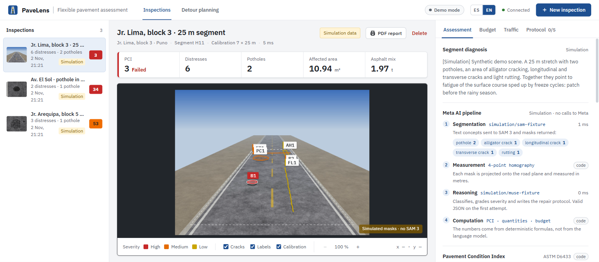
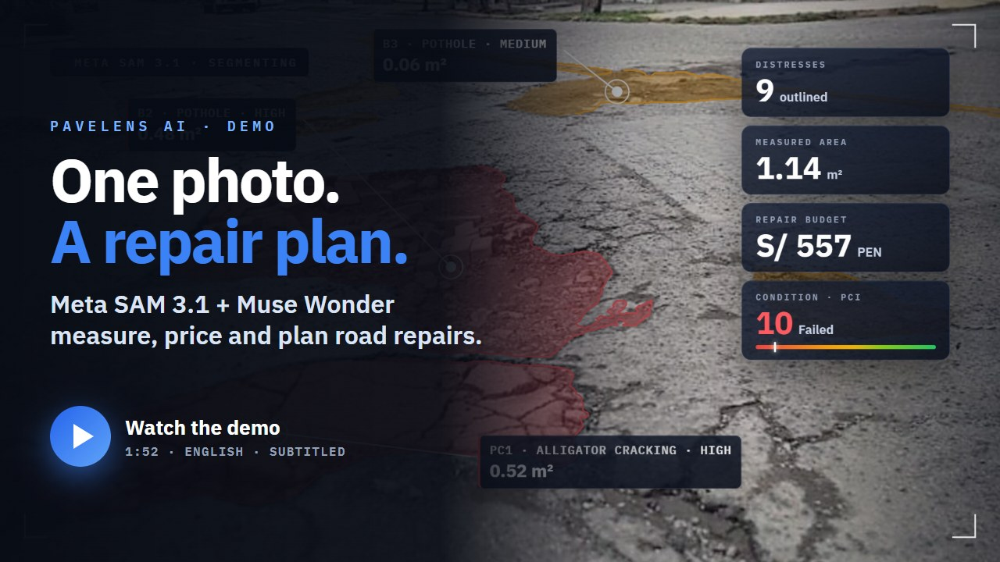
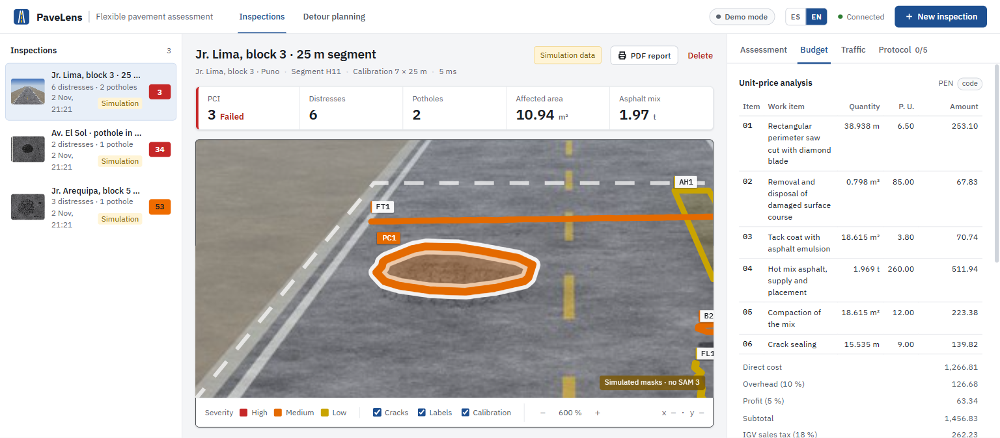
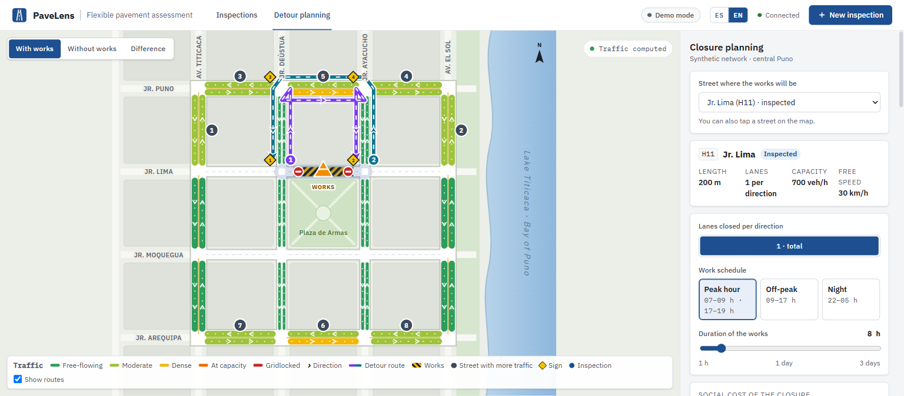

# PaveLens AI 🛣️

> **Meta Global AI Developer Hackathon · Indie Developer Track**
> From one road photo to a measured, priced and planned pavement repair. Meta SAM 3 outlines every distress, geometry turns it into real metres, code computes the Pavement Condition Index (ASTM D6433), the asphalt quantities and the budget, and Meta Muse Wonder diagnoses, explains and plans the works: the detour while a lane is closed and the crew's route for the day.

*Leer en español: [README.es.md](README.es.md)*



**Contents:** [What it is](#what-it-is) · [How it works](#how-it-works) · [Quick start](#quick-start) · [Configuration](#configuration-env) · [Troubleshooting](#troubleshooting) · [Project layout](#project-layout) · [Tests](#tests) · [Documentation](#documentation)

## Demo video

[](docs/media/PaveLens_AI_demo.mp4)

**[▶ Watch the demo (1:52, MP4)](docs/media/PaveLens_AI_demo.mp4)** · [YouTube](https://youtu.be/bFq20ClnQ1o) · [English subtitles (.srt)](docs/media/PaveLens_AI_demo.en.srt)

The video is a real run with the Meta models. The 89-second analysis is sped up and labelled as such.

## What it is

Road surveys are still done on foot, with a tape measure and a notebook. Severity ratings change from one inspector to another, patch quantities are guessed by eye, and nobody can check a budget against the damage. When a crew closes a lane, nobody models where the traffic goes. Municipalities such as **Puno, Peru** (3,827 m above sea level, nightly frost, strong UV) face this with very small maintenance budgets.

PaveLens is a web app for the road maintenance team of a municipality:

- the **inspector** takes a photo of the street and gets the damage measured in metres, the PCI and a priced repair;
- the **engineer** reviews the diagnosis, sets the depth measured in the field, and the quantities and budget are recalculated;
- the **planner** sees what closing the street does to traffic and in which time window it costs least;
- the **crew** gets the order of the day's works, the closure at each site and the route over real streets.

One rule runs through the whole app: **the AI decides and explains, code measures and computes.** Areas, tonnes, prices and the PCI are never written by a language model, so a hallucination cannot inflate a budget.

## How it works

```
 Photo + scale ──► Meta SAM 3 / 3.1 ──► Metres ──► Muse Wonder ──► PCI, quantities, budget ──► Traffic and crew plan
 (upload or        one polygon per      ground       code, type,      ASTM D6433, hot mix        Wardrop detours,
  camera)          distress             projection   severity, repair in tonnes, MTC prices     route on a real map
```

1. **Photo and scale.** For a top-down photo the visible road width is enough. For an angled photo the inspector marks the 4 corners of a known rectangle and PaveLens solves a homography; a 1 m grid drawn on the photo confirms it.
2. **Segmentation (Meta SAM 3 or 3.1).** The photo is sent with the concepts `pothole`, `alligator crack`, `longitudinal crack`, `transverse crack` and `rutting`. Each distress comes back as a polygon, not a box.
3. **Measurement.** Each polygon is projected to the ground: area, perimeter, length × width. The tests check every demo mask against its true area within 1 %.
4. **Diagnosis (Meta Muse Wonder).** An agent coordinator calls checked tools and specialists (diagnosis, mobility) and an independent reviewer checks the result. The model sees the photo plus the measurements already computed and returns code, severity, finding and repair as JSON, which is validated with one self-repair attempt. If something stays open, the inspection is marked *Needs review* and the screen says what to do next.
5. **PCI and budget.** PCI by ASTM D6433 (flagged as partial if the photo covers less than one 135 m² sample unit). Saw-cut patches, volume, tonnes of hot mix, and a budget with Peruvian MTC work items in soles (PEN), overhead, profit and IGV. A depth measured in the field recomputes everything.
6. **Detour planning.** Closing a lane on the demo network of central Puno: Wardrop traffic equilibrium (Frank-Wolfe + BPR) by time window, vehicle-hours lost, social cost, and a traffic management plan written by Muse Wonder.
7. **City maps.** Real OpenStreetMap streets for any area you choose, with reference detours around a closed segment.
8. **Maintenance route.** All inspections on a map, coloured by PCI. Choose the day's works: code computes the shortest order (nearest neighbour + 2-opt), Meta Muse Wonder decides the final order, the closure and the time window at each site and the risks, and code validates its answer. The route is drawn over real streets and animated, with the work zones marked. **OpenStreetMap is the default (no key, no account); Google Maps is optional.**

Everything works in **Spanish and English**, has an accessibility panel (text size, high contrast, reduced motion, colour-blind palette), and runs on a phone (camera, pinch zoom).

Each inspection shows a **Meta AI pipeline** panel that traces every step: the concepts sent to SAM, the masks returned, the projection, the model used, how many attempts its JSON needed and which numbers came from code.

| | |
|---|---|
|  |  |
| **Show on photo** zooms onto a distress; the budget is computed by code from the measured areas. | **Detour planning**: Wardrop equilibrium on the demo network of central Puno. |

## Quick start

You can run the full app **without any key**: it starts in **demo mode**, with fixed results that the interface labels *Demo mode*. Add a Meta key later to use the real models.

### 1. Requirements

| Tool | Version | Check it with | Download |
|---|---|---|---|
| Git | any | `git --version` | https://git-scm.com |
| .NET SDK | **10.0.100 or later** | `dotnet --list-sdks` | https://dotnet.microsoft.com/download/dotnet/10.0 |
| Node.js | **22.22+ or 24 LTS** (npm included) | `node --version` | https://nodejs.org |

Not needed: Docker, a database server, a GPU or any paid service. The API stores its data in a local SQLite file and the Meta models are called over the internet.

Ports **5000** (API) and **4200** (web app) must be free. On macOS, port 5000 is taken by *AirPlay Receiver*: turn it off in *System Settings → General → AirDrop & Handoff*, or see [Troubleshooting](#troubleshooting).

### 2. Clone

```bash
git clone https://github.com/CHARLS362/PaviLens.git
```

```bash
cd PaviLens
```

### 3. Start

Windows (PowerShell):

```powershell
powershell -ExecutionPolicy Bypass -File .\start.ps1
```

macOS / Linux:

```bash
bash start.sh
```

The script does four things:
1. checks .NET 10 and Node, and stops with a clear message if one is missing;
2. creates `.env` from `.env.example` on the first run;
3. installs the packages on the first run (1–3 minutes);
4. starts the API and the web app. On Windows each one opens in its own window: keep both open.

<details>
<summary>Start by hand instead (two terminals)</summary>

Terminal 1, the API, from the repository root:

```bash
dotnet run --project backend/src/PaveLens.Api --launch-profile http
```

Terminal 2, the web app:

```bash
cd frontend
```

```bash
npm ci
```

```bash
npm start
```

Copy `.env.example` to `.env` yourself if you want to set keys.
</details>

### 4. Open the app

Open **http://localhost:4200**. The first build takes about 30 seconds. The top bar must say **Connected**.

| What | URL |
|---|---|
| Web app | http://localhost:4200 |
| API reference (Scalar) | http://localhost:5000/scalar |
| Health check | http://localhost:5000/health |
| Active AI mode | http://localhost:5000/api/v1/ai/status |

The database is created on the first start with three demo inspections: Jr. Lima (calibrated angled photo), Av. El Sol (pothole) and Jr. Arequipa (alligator cracking).

### 5. Try it

1. **New inspection** → pick one of the sample scenes (the scale is already set) → **Analyse**.
2. Open the result: outlines on the photo, PCI, quantities and budget. Type a field depth to see everything recalculated.
3. **Detour planning**: close a street and compare time windows.
4. **Maintenance**: choose the day's works and click **Plan the day with Meta** to see the route on the map.

The [User guide](docs/USER_GUIDE.md) explains every screen.

## Configuration (`.env`)

All settings live in one file, **`.env` at the repository root** (next to this README). Git ignores it, so your keys stay on your machine. [`.env.example`](.env.example) is the commented template.

> ⚠️ **The API reads `.env` only when it starts.** After editing it, close the API window (or press Ctrl+C) and start again.

### Use the real Meta models

One key is enough. Get it at https://dev.meta.ai and put it in `.env`:

```dotenv
META_API_KEY=paste-your-meta-api-key-here
```

With that key, the mode switches to Meta and segmentation uses SAM 3.1 on Meta. On startup the API asks Meta which models your key can use and picks the best one (the newest Muse Wonder, else Muse Spark).

To confirm it worked, check either of these:
- the top bar shows the model names (for example *SAM 3.1 · Muse Wonder 1.0*) instead of *Demo mode*;
- http://localhost:5000/api/v1/ai/status reports `Meta`.

With the real models, **use a real road photo**: the sample scenes are drawings, so SAM finds no damage in them and the analysis stops with a clear message.

### All the settings

| Variable | Default | What it does |
|---|---|---|
| `PAVELENS_AI_PROVIDER` | `Auto` | `Auto` uses Meta when `META_API_KEY` is set, otherwise demo mode. `Simulation` forces demo mode; `Meta` requires the key. |
| `META_API_KEY` | empty | Meta key for Muse Wonder and, unless another service is chosen, SAM 3.1. |
| `META_REASONING_MODEL` | empty | Pins a model (for example `muse-spark-1.3`). Empty or `auto` picks the best one. |
| `PAVELENS_SEGMENTATION_SERVICE` | `Auto` | `Auto`: Roboflow if `ROBOFLOW_API_KEY` is set, otherwise Meta. Also `Roboflow`, `Meta` or `Sidecar`. |
| `ROBOFLOW_API_KEY` | empty | Free key from https://app.roboflow.com to run SAM 3 on Roboflow instead. |
| `META_SAM31_API_KEY` | empty | A separate key for SAM 3.1 only, if you have one. |
| `MAPS_PROVIDER` | `Osm` | The map shown first on the Maintenance screen: `Osm` (OpenStreetMap) or `Google`. Users can switch in the app. |
| `OSRM_URL` | public OSRM server | Street routing over OpenStreetMap. Point it at your own OSRM server for production. |
| `MAP_TILE_URL` | `tile.openstreetmap.org` | Map tiles (`{z}/{x}/{y}`). Use your own tile server or a provider for production. |
| `GOOGLE_MAPS_API_KEY` | empty | Optional. Enables the Google map and Google Routes. Without it everything runs on OpenStreetMap and nothing is sent to Google. |
| `GOOGLE_MAPS_BROWSER_KEY` | empty | Optional separate key for drawing the Google map; defaults to the one above. |

Any other setting from `backend/src/PaveLens.Api/appsettings.json` can be set in `.env` too, writing `__` instead of `:` (for example `Ai__Meta__Reasoning__TimeoutSeconds=120`). Order of precedence: real environment variables, then `.env`, then `dotnet user-secrets`, then `appsettings.json`.

What happens when a service is missing:

| Missing | What you get |
|---|---|
| No Meta key | Demo mode: the whole app works with fixed, labelled results. |
| SAM 3.1 helper not installed | The start script installs it (`backend/tools/sam31`, needs Node). By hand: `npm ci --prefix backend/tools/sam31`. |
| No internet for map tiles | The maintenance route is still planned; the map area shows a notice. |
| OSRM does not answer | The route uses straight-line distances at 22 km/h and says so. |
| Meta returns an invalid plan | The order computed by code is used, with a warning. |
| No Google key | OpenStreetMap only; the Google button is disabled. |

### Keep your keys safe

- Keys go **only** in `.env`: never in `appsettings.json`, the code, an issue or a screenshot. `git add .` never picks up `.env`.
- The browser never receives the Meta key. Calls to Meta, OSRM and Google Routes go through the PaveLens API, which limits how many requests each user can make; map routes are also cached and Google has a daily cap.
- The Google browser key is handed out only to the app's own pages. A browser key can still be seen in the page's network traffic, so **restrict it in Google Cloud Console**: by website (`http://localhost:4200/*` and your domain) and to the *Maps JavaScript API*.
- If a key is ever exposed, revoke it (https://dev.meta.ai, Google Cloud Console) and create a new one.

## Troubleshooting

| Symptom | Fix |
|---|---|
| `start.ps1 cannot be loaded because running scripts is disabled` | Run it as shown above: `powershell -ExecutionPolicy Bypass -File .\start.ps1`. |
| `A compatible .NET SDK was not found` | Install the .NET 10 SDK. Check with `dotnet --list-sdks`. |
| `The Angular CLI requires a minimum Node.js version` | Install Node 22.22+ or 24 LTS, then open a new terminal. |
| `npm ci` fails | Check your internet connection, delete `frontend/node_modules` and run the script again. |
| Port 5000 or 4200 already in use (on macOS, usually AirPlay) | Close the other program, or start the API with `--urls http://localhost:5055` and change the port in `frontend/proxy.conf.json`. |
| The top bar says *Disconnected* | The API is not running or is still starting. Look at its window for an error. |
| Still *Demo mode* after adding the key | Restart the API. Check the file is named exactly `.env` (not `.env.txt`) and sits next to `README.md`. On Windows, turn on *View → File name extensions* to see it. |
| API stops with `Ai:Meta:...:ApiKey es obligatorio` | `PAVELENS_AI_PROVIDER=Meta` or a chosen service needs a key that is empty in `.env`. |
| Real models answer 401/403 | The key is wrong, or the account has no access to that model. |
| SAM 3.1: `node` or `decode.mjs` not found | Run `npm ci --prefix backend/tools/sam31` and make sure `node` is on the PATH. |
| An analysis fails with *… found no distress in the photo* | SAM saw no damage. Expected with the drawn sample scenes in Meta mode. With your own photo, get closer, use even light and keep the damage in the lower half of the frame. |
| Maintenance map shows tiles out of place or no map | Reload the page. If you start the web app by hand, run `npm start` again after pulling new changes. |
| Start over with clean demo data | Stop the API and delete `backend/src/PaveLens.Api/App_Data/`. It is recreated on the next start. |

More cases are covered in [docs/GETTING_STARTED.md](docs/GETTING_STARTED.md#7-troubleshooting).

## Project layout

```
PaviLens/
├── backend/                         .NET 10, Clean Architecture
│   ├── PaveLens.slnx
│   ├── src/
│   │   ├── PaveLens.Domain/             Inspection, distresses, validated geometry
│   │   ├── PaveLens.Application/        Projection, PCI, quantities, budget, traffic, maintenance route
│   │   ├── PaveLens.Infrastructure/     EF Core (SQLite/PostgreSQL), queue + worker, Meta/Roboflow adapters, OSRM/Google
│   │   └── PaveLens.Api/                Minimal API /api/v1, ProblemDetails, rate limiting
│   ├── tests/                       Unit and integration tests (xUnit v3)
│   ├── tools/sam31/                 Small Node helper that decodes SAM 3.1 masks
│   └── samples/                     Demo scenes and their generator
├── frontend/                        Angular 22 (standalone components, signals), ES/EN
├── docs/                            Guides, screenshots and the demo video
├── .env.example                     Configuration template: copy to .env
└── start.ps1 / start.sh             Check requirements, create .env, install, start
```

## Tests

175 backend tests (unit and integration) and 19 frontend tests. Run the backend tests from `backend/`, where `global.json` lives:

```bash
cd backend
```

```bash
dotnet test --solution PaveLens.slnx
```

From the repository root, the frontend tests:

```bash
npm --prefix frontend test -- --watch=false
```

The tests never call Meta, Google or OSRM: they use fakes, so they run offline and for free.

## Documentation

- [docs/GETTING_STARTED.md](docs/GETTING_STARTED.md): installation step by step, every option and troubleshooting ([en español](docs/INSTALACION.es.md)).
- [docs/USER_GUIDE.md](docs/USER_GUIDE.md): how to use every screen, from the photo to the budget and the detour.
- [backend/README.md](backend/README.md): API reference and backend configuration.
- [backend/docs/ARCHITECTURE.md](backend/docs/ARCHITECTURE.md): layers, pipeline, engineering models and storage.
- [backend/docs/ORCHESTRATION.md](backend/docs/ORCHESTRATION.md): agent orchestration, regional profiles and city maps.
- [backend/docs/ai-contracts.md](backend/docs/ai-contracts.md): contracts with SAM 3 and Muse Wonder.

## Roadmap

Not implemented yet:

- Video inspection with SAM 3.1 (mask tracking across frames), aggregated by sample unit.
- Wardrop detour planning on real OpenStreetMap streets (today it runs on the demo network of central Puno; City maps already shows real streets with reference detours).
- Validation of the segmentation against the Crack500 and RDD2022 datasets.

## Author

**Carlos Turpo (CHARLS362)**
- Repository: [github.com/CHARLS362/PaviLens](https://github.com/CHARLS362/PaviLens)
- Developed for the **Meta Global AI Developer Hackathon 2026** (Indie Developer Track).

## License

[MIT](LICENSE) · Copyright (c) 2026 Carlos Turpo (CHARLS362)
