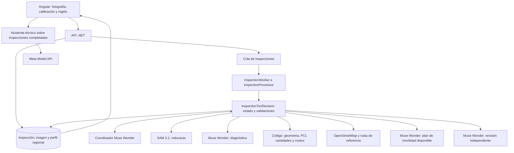

# Reporte técnico: orquestación agéntica con una clave de Meta

Proyecto: PaveLens AI. Fecha: 3 de noviembre de 2026, America/Lima.

## 1. Dictamen y alcance

El backend implementa una orquestación centralizada que permite utilizar una única credencial de Meta Model API para coordinador, diagnóstico, planificación de movilidad, revisión y asistente conversacional, además de SAM 3.1 directo. Para ello deben activarse simultáneamente `Ai:Provider=Meta` y `Ai:Meta:SegmentationService=Meta`.

Configurar solamente la clave no cambia el proveedor predeterminado: la aplicación sigue en simulación si no se activa `Ai:Provider`. Activar ese proveedor tampoco selecciona SAM directo automáticamente: la configuración existente conserva `Roboflow` como servicio de segmentación predeterminado.

La credencial autentica las llamadas de IA. El funcionamiento completo requiere además backend, frontend, base de datos, almacenamiento, Node.js para el parser SAM, fotografías calibradas y datos regionales. Los mapas utilizan OpenStreetMap/Overpass, que es un servicio separado de Meta.

Estado: código implementado, compilado y probado con simulación y respuestas HTTP controladas. No se ha ejecutado aquí una inspección completa contra una cuenta Meta real. La autorización efectiva de la clave, el acceso a los modelos, la latencia, el consumo y la precisión real siguen pendientes de comprobar.

## 2. Arquitectura de ejecución



La API recibe la fotografía y los parámetros, valida la solicitud, guarda el contexto regional y encola la inspección. Un worker crea una sesión aislada por análisis. El coordinador recibe el objetivo y las herramientas disponibles; el backend ejecuta cada llamada y devuelve su resultado al modelo.

El bucle utiliza Chat Completions, con definiciones `function`, `tool_choice=required`, argumentos JSON y resultados asociados mediante `tool_call_id`. La ejecución de herramientas es secuencial, incluso cuando el modelo propone varias en un turno: las operaciones comparten un estado que debe permanecer coherente. Este patrón corresponde al mecanismo de herramientas documentado por [Meta](https://dev.meta.ai/docs/tool-calling).

No es una red de agentes descentralizados ni un sistema que aprenda o se reconfigure por sí solo. Hay un coordinador con capacidad limitada de seleccionar llamadas y especialistas con contratos definidos. El trabajo del dominio continúa protegido por validaciones de código.

## 3. Roles, modelos y responsabilidad

| Rol | Implementación | Responsabilidad y límite |
| --- | --- | --- |
| Coordinador | `MetaInspectionCoordinator`, Muse Wonder | Selecciona herramientas y procesa sus resultados. No puede completar mediante una afirmación en texto. |
| Contexto regional | `RegionalCatalog` y herramienta de sesión | Carga una configuración aprobada y versionada. No busca ni aprueba automáticamente normativa nueva. |
| Contexto geográfico | `OverpassNetworkProvider` | Obtiene calles cuando existen coordenadas explícitas. No deduce la ubicación de la foto desde el centro de una región. |
| Percepción | `MetaSam31Segmenter`, SAM 3.1 | Devuelve máscaras por concepto. SAM es una herramienta de segmentación, no el coordinador. |
| Medición e ingeniería | Proyección, geometría, PCI, cantidades y costos en .NET | Calcula valores desde los datos y supuestos configurados. Repetir el cálculo con los mismos datos debe producir el mismo resultado. |
| Diagnóstico | `MetaReasoner`, Muse Wonder | Clasifica cada máscara medida y propone intervención y pasos. Tiene validación de formato y un intento de autocorrección. |
| Movilidad | `TrafficPlanService` y `MetaTrafficPlanner` | Redacta un plan sobre simulación y rutas candidatas verificadas. La integración actual del análisis usa el escenario sintético de Puno cuando corresponde. |
| Revisión | `MetaInspectionAuditor`, Muse Wonder | Revisa un JSON con medidas, hallazgos, presupuesto, advertencias y movilidad. Devuelve `Ready` o `NeedsReview`. |
| Asistente | `MetaMaintenanceAssistant`, Muse Wonder | Responde consultas sobre una inspección completada, con foto, resultados e historial de conversación. Se invoca aparte del flujo inicial. |

Los roles lingüísticos comparten actualmente `Ai:Meta:Reasoning:Model`; el valor predeterminado es `muse-wonder-1.0`. No hay selección automática de un modelo diferente por rol. Cambiar ese ajuste afecta coordinador y especialistas que utilizan `MetaChatClient`.

La revisión usa un contexto separado, pero comparte el modelo y puede compartir sus errores. No vuelve a segmentar la fotografía ni comprueba físicamente las medidas; su entrada actual es evidencia estructurada. La salida de revisión utiliza JSON Schema estricto, conforme al mecanismo de [salidas estructuradas de Meta](https://dev.meta.ai/docs/structured-output). La validez del esquema no demuestra que una conclusión de ingeniería sea correcta.

## 4. Herramientas y dependencias

| Herramienta | Prerrequisitos | Resultado |
| --- | --- | --- |
| `load_region` | Perfil guardado al crear la inspección | Región, versión, fuentes y cobertura de precios/normas. |
| `load_city_network` | Región cargada | Red real, información ausente o indisponibilidad explícita. |
| `segment_image` | Región cargada | Máscaras SAM. Solo permite conceptos habilitados. |
| `measure_segments` | Segmentación existente | Medidas proyectadas y superficie evaluada. |
| `diagnose_distresses` | Región y máscaras medidas | Un hallazgo por segmento y propuesta de intervención. |
| `compute_report` | Diagnóstico válido | Cantidades, PCI y presupuesto si hay precios locales. |
| `assess_mobility` | Informe calculado y contexto geográfico evaluado | Plan sobre el escenario compatible o información requerida para movilidad real. |
| `verify_report` | Informe calculado y movilidad evaluada | Comprobaciones de código y revisión del modelo. |
| `finish` | Revisión ejecutada | Finalización preliminar con su estado de revisión. |

La secuencia nominal recorre las nueve herramientas, aunque el coordinador puede repetir pasos dentro de sus límites. La decisión de repetir no elimina sus dependencias.

La sesión rechaza herramientas desconocidas y argumentos no permitidos. Repetir segmentación invalida medición, diagnóstico, cálculo, movilidad y revisión. Repetir medición o diagnóstico también invalida resultados posteriores. Se exige cobertura exacta de los segmentos medidos y códigos de deterioro únicos.

Una inspección puede terminar con `InspectionStatus=Completed` y `Orchestration.Status=NeedsReview`: se produjo un resultado preliminar con asuntos pendientes. `Ready` significa que la revisión programada no dejó observaciones; no constituye certificación de ingeniería.

## 5. Clave única, endpoints y flujo de datos

| Componente | Endpoint | Autenticación |
| --- | --- | --- |
| Coordinador y especialistas de lenguaje/visión | `https://api.meta.ai/v1/chat/completions` | `Ai:Meta:Reasoning:ApiKey`, cabecera Bearer. |
| SAM 3.1 directo | `https://api.meta.ai/v1/responses` | `Ai:Meta:Sam31:ApiKey`; si no está configurada, reutiliza la clave de razonamiento. |
| Mapa base | `https://tile.openstreetmap.org` | Solicitudes de imágenes del navegador; independiente de Meta. |
| Importación de calles | `https://overpass-api.de/api/interpreter` | Solicitud del backend; independiente de Meta. |

La documentación oficial confirma `muse-wonder-1.0` como identificador de Muse Wonder en [Meta Model API](https://dev.meta.ai/docs/overview), y que [SAM 3.1](https://dev.meta.ai/docs/sam/overview) utiliza la misma autenticación Bearer y acepta respuestas no transmitidas por streaming. El acceso concreto depende de la cuenta y de sus límites.

Las fotografías se envían a SAM y al especialista de diagnóstico; el asistente recibe también la foto al responder preguntas posteriores. El coordinador inicial recibe metadatos de la tarea y las salidas de herramientas. El revisor recibe evidencia estructurada. Estas transferencias deben tenerse en cuenta al definir qué imágenes se pueden analizar.

La clave reside en el backend. Angular no debe contenerla. `/api/v1/ai/status` devuelve proveedor, modelos, host y presencia de claves; no las expone. `keyConfigured=true` comprueba presencia, no realiza una autenticación real contra Meta.

## 6. SAM 3.1 y medición física

El adaptador envía una solicitud por concepto, con foto como data URL, `stream=false`, `mask_encoding=one_bit` y confianza solicitada. Los cinco conceptos predeterminados son `pothole`, `alligator crack`, `longitudinal crack`, `transverse crack` y `rutting`.

La respuesta se decodifica mediante el paquete oficial `@meta-sam/parser` 0.1.0. Un proceso Node local recibe la respuesta geométrica, no las claves ni la imagen original. Convierte contornos a coordenadas de la imagen y el backend elimina detecciones duplicadas entre conceptos.

Se requieren escala cenital válida o calibración por cuatro puntos y dimensiones conocidas. Los vértices originales se proyectan antes de simplificar el contorno usado para visualización. La altura/profundidad no se obtiene de una fotografía 2D: se usa un supuesto identificado hasta registrar una medición de campo.

Actualmente se rechazan máscaras con huecos porque el dominio no representa esa geometría. Una segmentación sin deterioros no se declara automáticamente pavimento sano: el flujo exige evidencia suficiente para continuar. El parser acepta un resultado vacío válido, pero la sesión lo trata como análisis que requiere corrección o revisión.

## 7. Configuración de activación directa

Ejecutar desde la raíz del repositorio. Requisitos: SDK .NET 10, runtime Node compatible con Angular y el parser, dependencias del frontend y del parser instaladas, conexión a Meta y acceso a los modelos de la cuenta.

```powershell
npm ci --prefix frontend
npm ci --prefix backend/tools/sam31 --ignore-scripts
```

Ejemplo de activación solo para el proceso y sus hijos, sin escribir la clave en el repositorio:

```powershell
$env:Ai__Provider = 'Meta'
$env:Seed__Enabled = 'false'
$env:Ai__Meta__SegmentationService = 'Meta'
$env:Ai__Meta__Reasoning__BaseUrl = 'https://api.meta.ai/v1/'
$env:Ai__Meta__Reasoning__Model = 'muse-wonder-1.0'
$env:Ai__Meta__Sam31__BaseUrl = 'https://api.meta.ai/v1/'
$env:Ai__Meta__Sam31__Model = 'sam-3.1'

$paveLensMetaCredential = Read-Host 'Clave de Meta Model API' -AsSecureString
$env:Ai__Meta__Reasoning__ApiKey = [System.Net.NetworkCredential]::new('', $paveLensMetaCredential).Password
# La misma credencial también sobrescribe cualquier clave SAM anterior.
$env:Ai__Meta__Sam31__ApiKey = $env:Ai__Meta__Reasoning__ApiKey

dotnet run --project backend/src/PaveLens.Api --launch-profile http
```

En otra terminal:

```powershell
npm --prefix frontend start
```

El perfil `http` inicia la API en `http://localhost:5000` y Angular utiliza `http://localhost:4200`. Las variables anteriores se limitan al entorno del proceso; para una configuración persistente de desarrollo pueden utilizarse `dotnet user-secrets`, y para un despliegue, el almacén de secretos del entorno. Si se deja sin configurar la clave específica SAM, el código utiliza la de razonamiento.

Se desactiva `Seed` porque, con una base vacía, las muestras automáticas pasan por el caso de uso real y pueden generar consumo Meta al arrancar. Las inspecciones pendientes o interrumpidas que ya existan también se recuperan automáticamente: revisar esa cola o utilizar una base de prueba aislada antes de habilitar la credencial. El perfil Development aplica las migraciones existentes a la base configurada al iniciar.

En despliegue hay que distribuir `backend/tools/sam31` y sus dependencias. `Ai:Meta:Sam31ParserScript` debe resolver a `decode.mjs`, preferiblemente mediante una ruta absoluta del servidor. `Ai:Meta:NodeExecutable` debe identificar el ejecutable Node. Los valores relativos actuales están pensados para el árbol de desarrollo.

Nota: el antiguo `configure-meta-keys.ps1` se retiró porque describía la integración anterior. Las claves se configuran ahora en el archivo `.env` de la raíz (ver `.env.example` y la guía de instalación del README): basta con `META_API_KEY`: el modo `Auto` activa Meta, usa SAM 3.1 directo y elige al arrancar los mejores modelos que permite la clave.

## 8. Límites de ejecución y consumo

| Ajuste | Valor actual predeterminado | Alcance |
| --- | --- | --- |
| `Orchestration:MaxToolCalls` | 16 | Llamadas de herramientas por ejecución; no cuenta las solicitudes internas a Meta como herramientas adicionales. |
| `Orchestration:MaxAttemptsPerTool` | 2 | Invocaciones por nombre de herramienta. |
| `Orchestration:TimeoutSeconds` | 300 | Tiempo máximo de la sesión de orquestación. |
| `Orchestration:MaxOutputTokens` | 2048 | Salida por turno del coordinador. |
| `Orchestration:MaxSegments` | 200 | Segmentos admitidos para el análisis. |
| `Ai:Meta:MaxSpecialistOutputTokens` | 8192 | Salida predeterminada de diagnóstico, movilidad y asistente. |
| Revisión estructurada | 2048 | Límite fijado actualmente en `CompleteStructuredAsync`. |
| Tiempo por intento HTTP | SAM: 60 s; razonamiento: 120 s | El pipeline HTTP permite hasta dos reintentos de transporte, sujeto a cancelación. |

Diagnóstico y plan de movilidad pueden realizar una segunda respuesta para reparar su JSON. Si el coordinador vuelve a invocar una herramienta, el consumo crece adicionalmente. Las consultas posteriores al asistente son solicitudes separadas y no están incluidas en la sesión inicial de 300 segundos.

Para estimar volumen lógico por inspección:

`solicitudes Meta = turnos del coordinador + conceptos SAM + intentos de diagnóstico + intentos de movilidad + revisiones`

Ejemplo ilustrativo: nueve turnos del coordinador, cinco conceptos SAM, un diagnóstico, un plan de movilidad y una revisión producen 17 solicitudes lógicas, antes de reintentos. Nueve herramientas no equivalen a nueve solicitudes HTTP. El coordinador puede agrupar varias herramientas en un turno, de modo que el número real varía.

Los tokens guardados en `AgentRunTrace` cubren el coordinador cuando finaliza correctamente. No incluyen todos los especialistas, SAM o reintentos HTTP; tampoco forman un registro completo de facturación para ejecuciones fallidas. Falta instrumentación agregada por solicitud para aplicar un presupuesto monetario por análisis.

## 9. Persistencia, recuperación y límites operativos

Cada acción ejecutada guarda rol, herramienta, modelo o procedencia determinista, estado, duración y evidencia. Se conserva el perfil regional serializado, las coordenadas suministradas, advertencias y el resultado disponible de movilidad dentro del JSON de traza existente.

La cola es un `Channel` en memoria con un solo consumidor. Al reiniciar, el worker consulta inspecciones pendientes o interrumpidas en la base de datos y las vuelve a encolar. La ejecución se reinicia; no se reanuda el historial del coordinador desde el último mensaje ni se evita por completo repetir llamadas facturables. Las ejecuciones anteriores no constituyen un diario inmutable de todas las versiones.

La cola actual no es un broker distribuido y no tiene capacidad acotada. Para varios workers o despliegues concurrentes hacen falta coordinación, límites de admisión y control de duplicados. El entorno actual es adecuado para una demostración controlada y una única instancia.

No existe un fallback automático a simulación cuando Meta falla. Los errores críticos producen un análisis fallido visible. La indisponibilidad de geografía puede permitir un informe preliminar con advertencias. Cambiar profundidad después del análisis recalcula con el perfil guardado y marca la revisión anterior como desactualizada; no ejecuta por sí solo una nueva auditoría LLM.

La API tiene limitación de solicitudes por IP, pero no autenticación/autorización de usuarios implementada. Antes de publicar una instancia con una clave facturable deben añadirse control de acceso y cuotas por usuario/proyecto. La protección de la clave en el servidor no impide que una API abierta reciba solicitudes que generen consumo.

## 10. Adaptación regional y mapas

Una región contiene identidad, versión, fuentes, supuestos de cantidades, precios, moneda y notas de contexto. La inspección guarda una copia antes de entrar en la cola. Cambiar el catálogo posteriormente no sustituye esa copia.

`pe-puno` conserva precios de referencia en PEN; `global-reference` no ofrece presupuesto local. Las fuentes se configuran como referencias: el sistema no las descarga para interpretar y aprobar nuevas leyes. El método de condición implementado es el modelo de referencia ASTM D6433.

Los mapas geográficos importan calles con dirección, accesos y ciertas restricciones de giro. Calculan recorridos de referencia para automóvil, sin demanda ni congestión observada. La red importada no alimenta automáticamente el equilibrio Wardrop/BPR: ese experimento sigue separado sobre la geometría y demanda sintéticas de Puno.

El coordinador tampoco dispone todavía de una herramienta para elegir y optimizar cierres sobre cualquier red geográfica importada. `load_city_network` obtiene contexto; `assess_mobility` utiliza el escenario de Puno compatible o registra los datos que faltan. No debe presentarse como planificación vial mundial validada.

## 11. Comprobación de una activación real

1. Consultar `GET /api/v1/ai/status`: debe indicar `provider=Meta`, segmentación `service=Meta`, modelo `sam-3.1` y razonamiento configurado. Esto todavía no prueba que la clave funcione.
2. Crear una inspección nueva desde la interfaz con fotografía calibrada, región e idioma. Los informes antiguos y las escenas previamente almacenadas no se convierten automáticamente en resultados reales.
3. Comprobar `GET /api/v1/inspections/{id}` y el panel de orquestación: deben aparecer acciones con modelos Meta y una ejecución concluida o un fallo explicable.
4. Comprobar consistencia entre máscaras medidas, diagnóstico, cantidades y presupuesto. Una región sin precios debe rechazar el presupuesto local.
5. Verificar que `NeedsReview` se conserve cuando falten profundidad, muestreo suficiente, normativa validada o demanda de tráfico. No forzar `Ready` para mejorar una demostración.
6. Probar una pregunta al asistente y, en el escenario sintético compatible, un plan de movilidad. Registrar consumo y latencia reales por llamada.
7. Probar rechazo de una llamada fuera de orden y fallo de proveedor sin simulación encubierta. Comparar resultados con mediciones de campo antes de afirmar precisión.

La verificación previa del repositorio comprende 98 pruebas unitarias .NET, 35 de integración, 10 Angular y 3 del parser SAM. Las llamadas de proveedores se probaron con simulación o HTTP controlado; el parser se ejecutó con el paquete oficial. Esas pruebas no reemplazan los pasos anteriores. En la prueba de red disponible, el mapa base cargó y Overpass agotó el tiempo de espera.

## 12. Trabajo necesario para cerrar la integración

| Prioridad | Trabajo | Criterio de aceptación |
| --- | --- | --- |
| Alta | Actualizar el configurador anterior para Meta nativo | Una clave, URLs oficiales, identificadores válidos y `SegmentationService=Meta` explícito. |
| Alta | Ejecutar inspección real con la cuenta Meta | SAM, coordinador, diagnóstico, revisión y asistente responden; trazas y fallos quedan visibles. |
| Alta | Medir precisión y costo total | Comparación con datos de campo y consumo agregado de todos los modelos e intentos. |
| Alta antes de publicar | Proteger acceso y consumo | Autenticación, autorización y cuotas por usuario/proyecto. |
| Media | Endurecer cola y recuperación | Admisión acotada, prevención de duplicados y política de reanudación/reintento documentada. |
| Media | Integrar movilidad geográfica real | Demanda calibrada, restricciones locales, escenarios de cierre y validación de rutas. |
| Media | Mejorar contratos e independencia de evaluación | JSON Schema en especialistas restantes y evaluación que contraste también evidencia visual/de campo. |

## 13. Archivos principales del repositorio

- [Contratos y herramientas](../backend/src/PaveLens.Application/Orchestration/AgentContracts.cs).
- [Sesión y validaciones](../backend/src/PaveLens.Application/Orchestration/InspectionToolSession.cs).
- [Procesador de inspecciones](../backend/src/PaveLens.Application/Inspections/InspectionProcessor.cs).
- [Coordinador y revisor Meta](../backend/src/PaveLens.Infrastructure/Ai/Meta/MetaAgents.cs).
- [Cliente Chat Completions](../backend/src/PaveLens.Infrastructure/Ai/Meta/MetaChatClient.cs).
- [Adaptador SAM 3.1](../backend/src/PaveLens.Infrastructure/Ai/Meta/MetaSam31Segmenter.cs).
- [Opciones de configuración](../backend/src/PaveLens.Infrastructure/Ai/AiOptions.cs).
- [Registro de proveedores](../backend/src/PaveLens.Infrastructure/DependencyInjection.cs).
- [Worker y recuperación](../backend/src/PaveLens.Infrastructure/Processing/InspectionWorker.cs).
- [Documentación de implementación](../backend/docs/ORCHESTRATION.md).

Las capacidades descritas se basan en estos archivos. Las referencias externas explican los contratos de Meta; no acreditan una ejecución real de esta aplicación.
