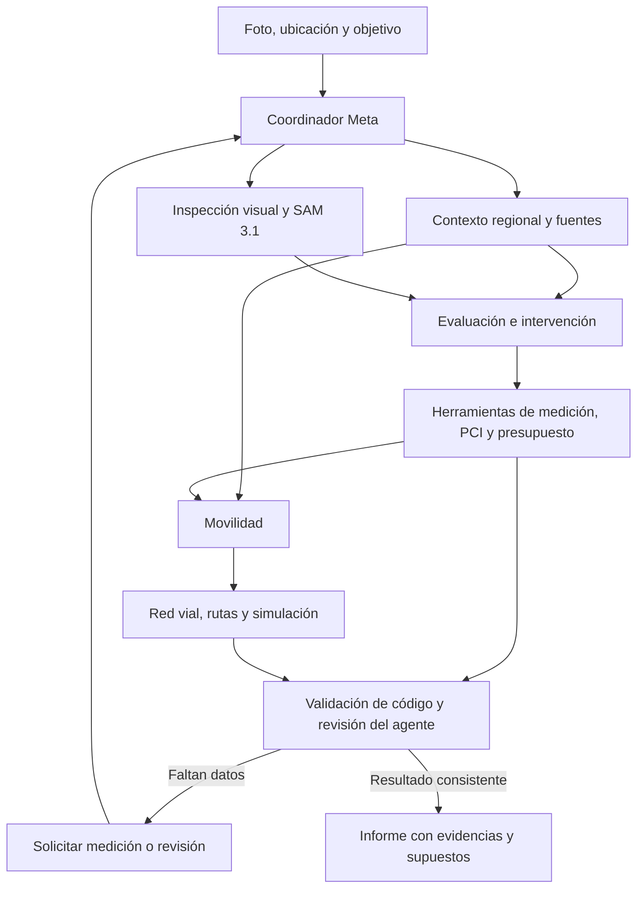

# Propuesta: orquestación de agentes Meta para PaveLens

Fecha de revisión: 2 de noviembre de 2026.

Estado: documento de diseño original. La orquestación, el adaptador directo SAM 3.1, los perfiles regionales y el mapa geográfico ya tienen una implementación inicial. Las aspiraciones de esta propuesta no equivalen a capacidades verificadas: consulta el [reporte de implementación](REPORTE_IMPLEMENTACION.es.md) y la [documentación técnica vigente](../backend/docs/ORCHESTRATION.md) para conocer el alcance y los límites reales.

## 1. Propuesta de valor técnica

Transformar PaveLens en una plataforma de agentes que prepare una evaluación de pavimento y alternativas de intervención, seleccione las herramientas adecuadas según la evidencia y la región, detecte información insuficiente y verifique los resultados antes de emitir un informe.

La autonomía se demuestra cuando el sistema elige una acción útil: solicitar una calibración, repetir una segmentación con otra indicación, consultar un perfil regional, comparar cierres o pedir una medición de campo. El número de agentes no demuestra por sí mismo mejor precisión.

Objetivo de adaptación: incorporar regiones mediante datos, reglas y algoritmos versionados. La cobertura declarada será la de los perfiles y escenarios efectivamente validados; cargar un mapa o traducir una interfaz no valida las normas de un país.

## 2. Base existente y cambios necesarios

Se pueden reutilizar la proyección al plano, las métricas geométricas, los estimadores de cantidades y costos, el cálculo de PCI, el motor de asignación de tráfico, la persistencia y los adaptadores actuales.

Puntos de cambio identificados:

- `InspectionProcessor` ejecuta una secuencia fija. Sus operaciones pueden exponerse como herramientas, conservando sus validaciones y dependencias.
- `MetaChatClient` devuelve texto y usa `json_object`; necesita incorporar llamadas a herramientas, resultados asociados a cada llamada y contratos con JSON Schema.
- `RoadSegment` representa una calle de dos sentidos. `TrafficPlanValidator` construye conexiones en ambos sentidos. Importar ciudades reales requiere modelar dirección, acceso por vehículo y restricciones de giro.
- `PunoDemoNetwork` es una red de demostración. Debe quedar como escenario identificable junto a un proveedor nuevo de redes geográficas.
- Los precios, condiciones y supuestos de Puno necesitan extraerse a un perfil regional sin alterar retroactivamente inspecciones guardadas.

La implementación propuesta permanece en .NET. El backend ejecuta el bucle de herramientas y controla el estado; Angular presenta resultados, evidencias y solicitudes al usuario.

## 3. Agentes y responsabilidades

| Rol propuesto | Modelo inicial a evaluar | Decisiones y herramientas |
| --- | --- | --- |
| Coordinador | Muse Wonder | Define el plan permitido, delega tareas, controla dependencias y solicita datos faltantes. |
| Contexto regional | Muse Spark | Recupera el perfil de región aprobado y su documentación; identifica información ausente. No activa normas nuevas sin revisión. |
| Inspección visual | Muse Spark con SAM 3.1 | Elige conceptos o indicaciones espaciales, llama a segmentación y evalúa si otra captura o indicación podría resolver un problema. |
| Evaluación e intervención | Muse Wonder | Clasifica los daños a partir de imagen y medidas, consulta referencias y llama a geometría, cantidades, PCI y presupuesto. |
| Movilidad | Muse Spark o Muse Wonder, según evaluación | Obtiene la red, propone escenarios y llama a rutas y asignación de tráfico; selecciona alternativas factibles. |
| Verificación | Muse Wonder y validadores de código | Contrasta resultados con evidencia y referencias. Solicita correcciones específicas o revisión humana cuando corresponde. |

Varios roles pueden usar el mismo modelo con contextos y herramientas diferentes. SAM 3.1 es una herramienta de percepción del agente visual, no un agente que planifique por sí solo.

La selección entre Wonder y Spark debe decidirse con mediciones de calidad, costo y latencia sobre nuestros casos. No se presupone que un modelo es mejor para ingeniería por su nombre comercial.

## 4. Ejecución controlada

El backend hace cumplir el orden y los permisos. Los agentes eligen acciones dentro del flujo disponible. Las operaciones independientes, como recuperar el contexto regional y analizar visualmente la imagen, pueden ejecutarse en paralelo.

Cada herramienta declara nombre, versión, esquema de entrada, esquema de salida y condiciones de ejecución. Ejemplos propuestos:

- `get_region_profile(regionId, version)`
- `segment_distress(imageId, concept, spatialPrompt)`
- `measure_masks(inspectionId, calibrationId)`
- `compute_quantities(inspectionId, profileVersion)`
- `compute_condition(inspectionId, methodVersion)`
- `estimate_budget(inspectionId, priceBookVersion)`
- `load_road_network(areaId, snapshotId)`
- `simulate_closure(networkId, closure, demandScenarioId)`
- `verify_report(runId)`

Las herramientas calculan los números y comprueban unidades, referencias y topología. Un agente no puede cambiar un total calculado para hacerlo coincidir con su explicación.

## 5. Precisión y recuperación de errores

Los esquemas estructurados validan la forma de las respuestas. La corrección factual y técnica exige controles adicionales:

1. Validar calidad de entrada y calibración antes de aceptar medidas.
2. Identificar cada segmento y comprobar que recibe diagnóstico o una exclusión explicada.
3. Comprobar cobertura, duplicados y correspondencia entre máscara y hallazgo.
4. Distinguir datos medidos, inferidos y supuestos en cada resultado.
5. Validar unidades, fórmulas, cantidades, totales y versiones de precios en código.
6. Validar dirección, acceso, giros y cierres en cada recorrido propuesto.
7. Verificar que las referencias regionales existen y corresponden al perfil seleccionado.

El acuerdo entre dos agentes no sustituye una medición ni valida una norma. Los errores de varios agentes pueden estar correlacionados.

Política inicial propuesta: hasta dos intentos de corrección por etapa, con límites configurables de llamadas, tokens, tiempo y costo. Si una corrección no aporta evidencia suficiente, finalizar con una solicitud concreta de datos o revisión.

Estados propuestos de ejecución: `Running`, `NeedsInput`, `NeedsReview`, `Completed` y `Failed`. No se marcará una etapa incompleta como completada mediante datos de simulación.

Persistir por ejecución: imagen y hash, calibración, perfil regional, fuentes y fechas, versiones de modelos y herramientas, entradas y salidas de herramientas, validaciones, costo y latencia. La interfaz puede mostrar un resumen de acciones y resultados verificables.

## 6. Adaptación por país y región

Un perfil regional aprobado incluiría:

- Identificador de país, región, idioma, moneda, unidades y zona horaria.
- Tipos de pavimento y métodos de evaluación implementados y soportados.
- Documentos técnicos de referencia: organismo, versión, fecha, localización del contenido y condiciones de uso.
- Catálogo de intervenciones, materiales y restricciones de aplicación.
- Libro de precios con fuente, moneda y fecha de vigencia.
- Factores económicos aplicables, horarios permitidos y parámetros del valor del tiempo cuando estén disponibles.
- Supuestos autorizados y requisitos de revisión.

La selección del perfil se propone a partir de ubicación y datos del proyecto, y el usuario puede corregirla. El país por sí solo no determina el método técnico de una entidad contratante.

Muse puede ayudar a extraer un perfil candidato de documentos aportados o recuperados desde fuentes autorizadas. Ese candidato requiere validación antes de quedar disponible como perfil aprobado. Si no existe uno adecuado, el sistema indica la cobertura disponible y solicita los datos faltantes.

La extensión a otros dominios, como pavimento rígido o drenaje, requiere herramientas, taxonomías y evaluaciones propias. La reutilización corresponde a la orquestación y la gestión de evidencia.

## 7. Mapas de ciudades reales

Propuesta de componentes:

- OpenStreetMap como una fuente posible de geometría y atributos de calles.
- Overpass o extractos geográficos para importar un área acotada y guardar una instantánea reproducible.
- MapLibre GL JS para presentar el mapa, daños, cierres y alternativas con capas geográficas.
- Un grafo dirigido para las herramientas de rutas y el motor de tráfico.

La importación deberá conservar o representar sentidos, accesos, restricciones de giro y atributos disponibles. Los carriles, velocidades o restricciones desconocidos se marcan como faltantes o supuestos.

Tener la geometría de una ciudad no proporciona automáticamente demanda, aforos ni capacidades calibradas. El sistema distinguirá: mapa real, atributos observados o supuestos y escenario de demanda. Cuando falten aforos, el resultado será una simulación de escenario identificada como tal.

Las rutas deben utilizar la misma instantánea y las mismas restricciones de cierre que la simulación. Un servicio externo de rutas no conocerá automáticamente el cierre aplicado solo dentro de PaveLens.

La atribución y las condiciones de distribución de los datos se incorporan al diseño. Los servicios de mapas y consultas tendrán proveedor, condiciones de uso y caché definidos antes del despliegue.

## 8. Demostrar la contribución técnica

Comparar el pipeline actual y la versión con agentes sobre las mismas entradas y los mismos perfiles. Medir:

| Dimensión | Evidencia propuesta |
| --- | --- |
| Percepción | Coincidencia de máscaras con anotaciones, omisiones y falsos positivos por tipo de daño. |
| Medición | Error respecto de mediciones de campo y sensibilidad a la calibración. |
| Diagnóstico | Acuerdo con revisión técnica y errores por severidad. |
| Presupuesto | Reproducción de cantidades y costos con el mismo libro de precios. |
| Movilidad | Recorridos factibles, restricciones respetadas y desempeño de la asignación. |
| Adaptación | Cambios correctos de unidades, precios, referencias y reglas entre perfiles verificados. |
| Recuperación | Errores detectados y corregidos, solicitudes justificadas de datos y casos pendientes de revisión. |
| Operación | Latencia, costo, número de llamadas y tasa de finalización. |

Publicar tamaño de muestra y resultados reales. Un error geométrico pequeño en máscaras sintéticas no demuestra la misma precisión sobre deterioros reales. Los límites y umbrales se fijarán con evidencia, no mediante un porcentaje de confianza inventado por el modelo.

## 9. Entrega acotada para el hackathon

La página pública consultada indica cierre el 4 de noviembre de 2026 a las 21:00 ET. Propuesta de ejecución por etapas, sin asumir que todas caben antes del cierre:

1. Un recorrido real completo con Meta y herramientas actuales: foto, medidas, diagnóstico, cantidades, presupuesto y validación.
2. Coordinador, agente de inspección y agente verificador funcionales, con decisiones y solicitudes de datos registradas. Contexto regional y movilidad pueden comenzar como herramientas de estos agentes.
3. Una red geográfica real acotada y un perfil regional aprobado. Incorporar un segundo perfil verificable para demostrar adaptación si el recorrido anterior está estable.
4. Comparación frente al pipeline actual, demostración reproducible y presentación de resultados.
5. Extender roles, ciudades, video y dominios según resultados de evaluación.

Un ejemplo de demostración sería detectar una calibración insuficiente, solicitar una corrección, recalcular el presupuesto con una profundidad medida y comparar cierres factibles. Una segunda ejecución mostraría qué cambia al seleccionar otro perfil regional y qué información adicional se requiere.

## 10. Encaje con Meta y alcance de lo verificado

Las páginas públicas del evento promueven aplicaciones de los modelos a problemas del mundo real y describen el track Indie mediante creatividad, ambición técnica y funcionamiento. La orquestación propuesta encaja conceptualmente con esas orientaciones.

La documentación de Meta permite implementar agentes con llamadas a herramientas y modelos Muse, así como usar SAM 3.1 para percepción. Este encaje técnico no acredita por sí solo el cumplimiento de todas las bases finales del concurso. En las páginas públicas consultadas no se pudo verificar el texto completo de esas reglas ni la ponderación de evaluación recogida en `DESAFIO.md`; deben contrastarse con las bases disponibles para participantes.

La candidatura deberá identificar con claridad capacidades implementadas, resultados reales, escenarios simulados, procedencia de datos y trabajo realizado durante el evento según sus bases aplicables.

## Fuentes primarias consultadas

- Evento: https://cerebralvalley.ai/e/meta-ai-developer-hackathon
- Agentes con modelos Meta: https://dev.meta.ai/docs/agent-frameworks
- Llamadas a herramientas: https://dev.meta.ai/docs/tool-calling
- Salida estructurada: https://dev.meta.ai/docs/structured-output
- Segmentación SAM: https://dev.meta.ai/docs/sam/overview
- Datos geográficos: https://wiki.openstreetmap.org/wiki/Overpass_API
- Visualización: https://maplibre.org/maplibre-gl-js/docs/
- Licencia y atribución OSM: https://www.openstreetmap.org/copyright
