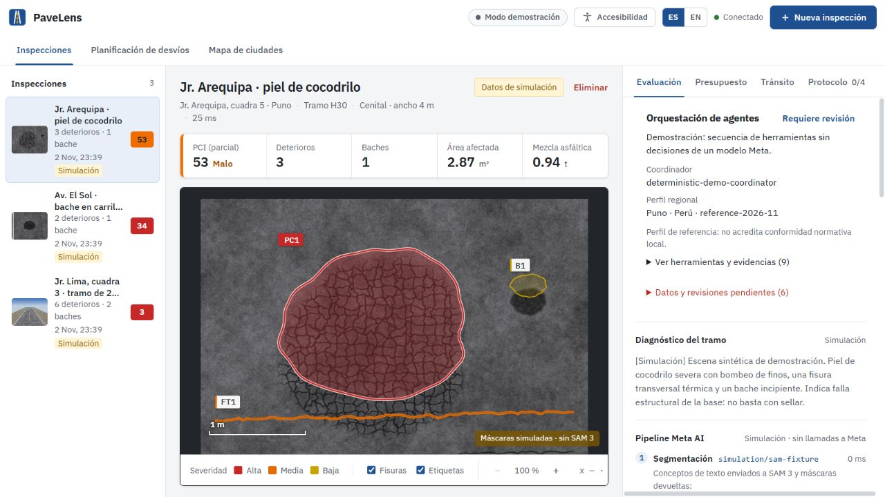

# Reporte de PaveLens: implementación y preparación para el hackathon

Revisión: 2 de noviembre de 2026, America/Lima.

## Resultado

Se implementó una primera orquestación ejecutable de herramientas y especialistas para inspecciones de pavimento. El backend permite que un coordinador de Meta elija llamadas, recibe sus resultados, aplica dependencias y exige verificación antes de terminar. El modo de demostración usa el mismo conjunto de herramientas con una secuencia determinista y se identifica como simulación.

La implementación local está compilada y probada. La precisión con fotografías reales, el acceso efectivo de la cuenta a los modelos Meta y la importación geográfica en vivo siguen pendientes de validación. No se ha demostrado adaptación normativa automática a todos los países.

## Qué encontré del trabajo anterior

El repositorio ya tenía una base importante: Angular, API .NET, segmentación, calibración por homografía, medidas, diagnóstico, PCI, cantidades, presupuesto y un experimento de tráfico sintético en Puno. No era una maqueta vacía.

Había cambios locales de documentación y accesibilidad, y eliminaciones preparadas del componente de impresión/PDF. Los conservé. No encontré un historial de Claude que permitiera reconstruir con certeza su lista pendiente; la revisión se basó en el código y su comportamiento observable.

## Qué quedó implementado

| Área | Resultado concreto |
| --- | --- |
| Coordinación | Bucle de llamadas a herramientas mediante Meta Model API, con límites de tiempo, llamadas, intentos y tokens por respuesta. |
| Especialistas | Segmentación, diagnóstico, movilidad y revisión independiente; contexto regional y cálculo determinista expuestos como herramientas. Un rol no implica un modelo distinto. |
| Integridad | No se acepta terminar antes de verificar. Repetir segmentación invalida los resultados dependientes. Se exige un diagnóstico por máscara medida. |
| Evidencia | Por herramienta: función, modelo o código, duración, estado y salida. Se guardan ejecuciones parciales y fallos. No se expone razonamiento privado del modelo. |
| SAM 3.1 directo | Adaptador para `/responses`, con decodificación de máscaras mediante el paquete oficial `@meta-sam/parser`. Se conservan Roboflow y Sidecar como opciones. |
| Ingeniería | Geometría, cantidades, PCI y costos siguen calculándose en código. Una revisión del modelo no reemplaza esos valores. |
| Regiones | Catálogo configurable, perfil versionado guardado con cada inspección y contexto enviado a diagnóstico/asistente. Una región sin precios locales no recibe un presupuesto peruano por defecto. |
| Mapas | Vista de ciudades con coordenadas, áreas acotadas de OpenStreetMap, selección de calles y cálculo de desvíos de referencia sobre grafo dirigido. |
| Frontend | Estado de la orquestación, evidencias desplegables, datos pendientes, selección regional y coordenadas en la captura. |

La configuración y los límites están explicados en [ORCHESTRATION.md](../backend/docs/ORCHESTRATION.md). Existe un [ejemplo de perfil regional](../backend/docs/region-profile.example.json).

## Frontend: apariencia y accesibilidad

Mi evaluación es que la interfaz tiene un flujo específico de ingeniería: foto calibrada, deterioros seleccionables, cantidades, presupuesto y decisiones sobre cierres. Eso le da identidad. La disposición en paneles y los controles se parecen a aplicaciones administrativas comunes; el aspecto visual por sí solo no permite determinar quién escribió el código ni si se utilizó IA.

Se corrigieron problemas observados:

- El selector de archivos estaba oculto con `display:none`, lo que impedía alcanzarlo con teclado. Ahora permanece enfocable y el área muestra el foco.
- Un `role=listitem` sobrescribía la semántica de los botones de inspección. La lista conserva su estructura y los controles vuelven a anunciarse como botones.
- Se ajustó la cabecera para que sus módulos puedan distribuirse en varias filas.
- Se corrigió el encabezado del diálogo para mantener visible el cierre a 320 px; su objetivo táctil mide 44 px.
- El mapa puede manejarse con teclado y botones. La lista de calles ofrece una alternativa a pulsar una línea del mapa.
- El historial de herramientas y las advertencias se pueden desplegar para conservar espacio para el diagnóstico.

Se inspeccionaron capturas y el árbol de accesibilidad del navegador. A 320 px, el documento y su ancho desplazable midieron 320 px y el cierre permaneció dentro del diálogo. Esto no equivale a una certificación WCAG: quedan pruebas con lectores de pantalla reales, usuarios, zoom de navegador y medición sistemática del contraste.

A 768 px con el texto al 130 %, el documento mantuvo un ancho desplazable de 768 px y los tres módulos de navegación quedaron dentro de la pantalla, con botones de 44 px de alto. Se restauraron las preferencias y el tamaño del navegador después de la prueba.

La mejora de producto más importante es jerarquizar qué debe hacer el inspector después: confirmar profundidad, corregir calibración, completar precios o revisar un cierre. Una pantalla con muchos datos técnicos necesita una acción prioritaria clara.

## Pruebas y límites comprobados

| Verificación | Resultado |
| --- | --- |
| Compilación de la solución .NET | Correcta, 0 advertencias y 0 errores. |
| Pruebas unitarias .NET | 98 aprobadas. |
| Pruebas de integración de API | 35 aprobadas. |
| Pruebas Angular | 10 aprobadas. |
| Pruebas del decodificador SAM | 3 aprobadas con formato documentado y parser real. |
| Compilación Angular de producción | Correcta; advertencia de paquete inicial de unos 589 kB frente al umbral de advertencia de 500 kB. |

Son 146 pruebas aprobadas. Las pruebas de proveedores usan simulación o HTTP simulado; las del parser sí ejecutan el paquete oficial. No se realizaron llamadas facturables a Meta con credenciales reales.

La consulta en vivo a Overpass agotó el tiempo de espera en este entorno. Se corrigió su manejo para producir un error de disponibilidad con una indicación útil, en lugar de «Error interno». La importación y el cálculo de rutas tienen pruebas con datos controlados; no se presenta la conexión geográfica en vivo como validada.

La nueva orquestación se guarda en el JSON de trazas existente y no agrega migraciones. Durante un reinicio de verificación, Development aplicó tres migraciones ya existentes a `backend/src/PaveLens.Api/App_Data/pavelens.db`. Se corrigió la configuración del proceso para continuar con `.build-user/verify.db` y almacenamiento de imágenes separado. No se intentó revertir esas migraciones ni eliminar datos del usuario.

## Qué todavía no puede prometerse

- **Precisión elevada demostrada:** hace falta un conjunto de fotos reales con anotaciones y mediciones de referencia. La confianza de una máscara no mide la precisión del presupuesto o del diagnóstico.
- **Cumplimiento mundial:** hay perfiles configurables, no un sistema que apruebe o actualice autónomamente normas de cualquier país. Solo se admite el método de condición actualmente implementado.
- **Tráfico real global:** los nuevos mapas calculan rutas de referencia sin demanda ni congestión observada. El experimento Wardrop/BPR de Puno sigue usando una red y demanda sintéticas.
- **Uso general para cualquier software:** la arquitectura permite ampliar herramientas, pero los especialistas actuales están diseñados para pavimentos.
- **Geometría universal de SAM:** se rechazan máscaras con huecos porque el dominio actual admite un polígono por componente. No se rellenan silenciosamente.
- **Validación Meta de extremo a extremo:** falta comprobar una inspección completa con la cuenta y los modelos habilitados, midiendo latencia, consumo y calidad.

## Innovación y presentación al hackathon

La contribución defendible es conectar percepción visual, medición física, cálculo de intervención y decisiones de movilidad en una ejecución verificable que detecta cuándo le faltan datos. No basta con aumentar el número de roles para demostrar innovación o precisión. No se realizó un estudio exhaustivo de productos o publicaciones que permita afirmar novedad mundial.

La [página oficial del hackathon](https://dev.meta.ai/events/global-hackathon) presenta para la categoría independiente creatividad, ambición técnica y funcionamiento, y los temas «Build for Your World» y «Push the Frontier». Mi interpretación es que PaveLens encaja como aplicación de modelos Meta a infraestructura física. Esa afinidad temática no certifica el cumplimiento de todas las bases: la misma página remite a reglas oficiales para participantes y no permitió verificar aquí su texto completo.

Antes de enviar el proyecto, las prioridades son:

1. **Una demostración real completa.** Foto calibrada → SAM 3.1 → diagnóstico → medidas/costos → revisión, con llamadas Meta reales y fallos visibles.
2. **Una evaluación pequeña pero honesta.** Comparar contra anotaciones y mediciones de referencia; reportar detección, error de área/cantidades, acuerdo de severidad, latencia y consumo. Comparar también con la secuencia fija anterior para comprobar si la orquestación mejora algo.
3. **Un caso regional contrastante.** Mostrar Puno con su perfil de referencia y una segunda región sin precios; evidenciar que el sistema solicita lo que falta en vez de inventar un presupuesto.
4. **Un caso de recuperación.** Enseñar cómo una llamada fuera de orden se rechaza, una nueva segmentación invalida la revisión o la falta de datos provoca `NeedsReview`.
5. **Entrega conforme al portal.** Revisar las reglas completas, requisitos del video/repositorio, atribuciones y licencias en el portal de participante. La fecha pública de entrega es el 4 de noviembre de 2026 a las 21:00 ET, sujeta a cambios publicados por Meta.

El alcance local está implementado y validado con las pruebas descritas. La siguiente evidencia decisiva para competir es una evaluación con Meta y datos de campo, no una afirmación de autonomía o cumplimiento universal.

## Limpieza de código del 3 de noviembre de 2026

Se retiraron el enrutador Angular sin rutas y su dependencia, el archivo de rutas vacío, el CSS raíz que solo contenía un comentario y un import innecesario de .NET. Se eliminaron estilos globales sin referencias de formularios, estados de tráfico y la antigua carga de fotografías. Los estilos activos de carga se consolidaron en el componente de captura, conservando el selector de archivos enfocable y su cobertura completa del área de carga.

Se conservaron las clases de riesgo y severidad generadas dinámicamente, los proveedores alternativos de IA, las simulaciones, las migraciones y las pruebas que sí tienen uso. Se activaron `noUnusedLocals` y `noUnusedParameters` para comprobar futuros cambios de TypeScript.

Verificación posterior a la limpieza: solución .NET compilada sin advertencias ni errores, compilación Angular correcta, 10 pruebas del frontend aprobadas y comprobación TypeScript de aplicación y pruebas sin errores. El paquete inicial de producción bajó de 589.68 kB a 510.21 kB; sigue existiendo una advertencia al superar el umbral de 500 kB por 10.21 kB. Los paquetes restantes conservaron sus versiones en el lockfile.
